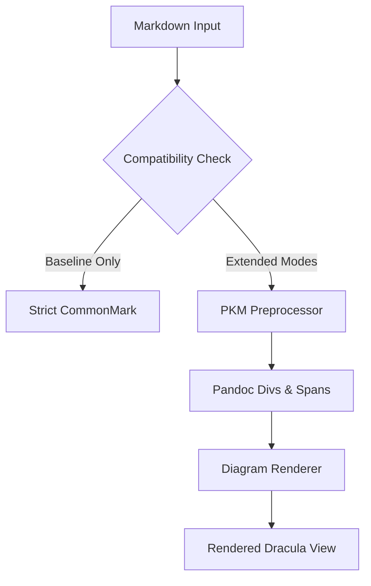
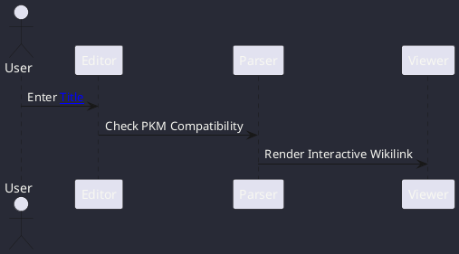

# ArtfulType Pro — Compatibility & Standards Showcase

This document demonstrates every supported syntax flavor, modern note-taking extension, technical publishing format, and compatibility standard supported by **ArtfulType Pro v0.30.12**.

> [!TIP]
> **Compatibility Toggle Note**: 
> You can toggle any of the 9 modular standards in the **Markdown Compatibility** menu in the top bar.
> When **Baseline Only** is selected, all extensions are stripped and the document strictly adheres to pure CommonMark.

---

## 1. Frontmatter Formats

ArtfulType Pro natively parses all three industry-standard metadata headers:

### YAML Frontmatter (Active above)
```yaml
---
title: "Document Title"
tags: [pkm, documentation]
---
```

### TOML Frontmatter
```toml
+++
title = "TOML Standard"
version = "0.30.12"
features = ["wikilinks", "citations", "diagrams"]
+++
```

### JSON Frontmatter (Pandoc & Static Site Generators)
```json
;;;
{
  "title": "JSON Metadata",
  "published": true,
  "standards": ["CommonMark", "Pandoc", "PKM"]
}
;;;
```

---

## 2. Modern Note-Taking & PKM Standards (Obsidian / Logseq / Roam)

### Text Highlighting
Modern note apps standardize on equal signs for highlights:
Here is ==critical research text highlighted in fluorescent yellow== for quick visual scanning.

### Internal Wikilinks & Navigation
* Standard note link: [[System Architecture]]
* Note link with custom alias: [[System Architecture|Click here to inspect the Architecture]]
* Sub-heading wikilink: [[Security Model#Threat Mitigation]]

### Transclusions & Embeds
Transclude external notes or media directly into the flow:

* Transcluded Note Card:
![[Architecture Overview]]

* Transcluded Asset / Graphic:
![[system-topology.png]]

---

## 3. Technical Documentation & Pandoc Extensions

### Pandoc Fenced Div Containers
Fenced divs format structured callout containers:

::: warning
**Caution: Production Cluster**
Ensure all configuration catalogs are compiled by `pp-server.space.mil` before restarting agent services.
:::

::: note
**Pandoc Callout Note**
This is a standard fenced container parsed from `::: note` syntax.
:::

::: tip
**Pro Tip**
Custom styling can also use explicit attributes like `::: {.callout-tip}`.
:::

### Bracketed Spans with Custom CSS Classes
Pandoc allows inline spans to receive CSS classes and IDs:
This is a normal paragraph containing [a high-priority tag]{.badge .primary #release-status} and [highlighted inline text]{.custom-callout} formatted via Pandoc bracketed attributes.

### Pandoc Citations
* In-text author citation: @knuth1984 investigated the algorithmic complexity of literate programming.
* Parenthetical citation: Distributed state convergence is mathematically proven [@lamport1978; @turing1950].
* Composite citation: As detailed by recent findings [@vibe2026, pp. 42-45].

### Inline Footnotes
Pandoc inline footnotes do not require a separate reference tag at the bottom of the page:
Here is a factual statement^[This footnote was written inline using Pandoc caret-bracket syntax and automatically anchored to the bottom footnote list.].

---

## 4. Technical Diagrams & Data Visualizations (7 Engines)

### Vega-Lite Diagram (`vegalite`)
```vegalite
{
  "$schema": "https://vega.github.io/schema/vega-lite/v5.json",
  "description": "Daily Note Ingestion Volume",
  "data": {
    "values": [
      {"flavor": "CommonMark", "usage": 45},
      {"flavor": "GFM", "usage": 92},
      {"flavor": "PKM", "usage": 85},
      {"flavor": "Pandoc", "usage": 78},
      {"flavor": "R Markdown", "usage": 64}
    ]
  },
  "mark": "bar",
  "encoding": {
    "x": {"field": "flavor", "type": "nominal", "axis": {"labelAngle": 0}},
    "y": {"field": "usage", "type": "quantitative"}
  }
}
```

### Mermaid Diagram (`mermaid`)


### PlantUML (`plantuml`)


### D2 (`d2`)
```d2
client: Client Node {
  shape: person
}
puppet: Puppet Master {
  shape: cylinder
}
client -> puppet: Request Catalog
puppet -> client: Distribute .deb Package
```

### Svgbob ASCII Diagram (`svgbob`)
```svgbob
 +-----------------+      +-----------------+
 |   Markdown      | ---> |  ArtfulType     | ---> [ Preview ]
 |   Document      |      |  Compiler       |
 +-----------------+      +-----------------+
```

### Markmap Mindmap (`markmap`)
```markmap
# ArtfulType Pro
## Note-Taking
### [[Wikilinks]]
### ==Highlights==
## Technical Publishing
### Pandoc Fenced Divs
### @Citations
### Vega Charts
## Ingestion
### Smart Typography
### YAML / TOML / JSON
```

---

## 5. Smart Typography (SmartyPants)

When **Smart Typography** is enabled:
* **Smart Double Quotes**: "Hello World" $\rightarrow$ “Hello World”
* **Smart Single Quotes**: 'It works' $\rightarrow$ ‘It works’
* **En-dash**: Range 10--20 items $\rightarrow$ 10–20 items
* **Em-dash**: Distraction-free editing---with Dracula theme $\rightarrow$ Distraction-free editing—with Dracula theme
* **Ellipses**: Loading... $\rightarrow$ Loading…

*(When "Baseline Only" is selected, quotes remain strictly straight: `"..."`, `'...'`, `--`)*

---

## 6. MDX & Component Support

For modern technical documentation and Jamstack publishing:

<Card title="Dracula Dark Mode">
ArtfulType Pro includes curated HSL palettes matching the official Dracula theme specification with high contrast syntax tokens.
</Card>

<Badge variant="success">v0.30.12 Verified</Badge> <Badge variant="info">Puppet Deployed</Badge>

<Tabs>
Tab 1: Desktop GUI (WebKit / GTK)
Tab 2: Terminal UI (`art` Ratatui binary)
</Tabs>

---

## 7. Extended Standards (GFM, Extra, MultiMarkdown, R Markdown)

### GFM (GitHub Flavored Markdown)
- [x] Task lists with reactive checkboxes
- [x] Strikethrough syntax: ~~legacy architecture~~ $\rightarrow$ modern modular pipeline
- [x] Automatic autolinks: https://space.mil

| Standard | Syntax Trigger | Status | Performance |
| :--- | :---: | :---: | ---: |
| **CommonMark** | Baseline | Always Active | $<1\text{ms}$ |
| **PKM / Obsidian** | `[[...]]`, `==...==` | Selectable | $<2\text{ms}$ |
| **Pandoc** | `:::`, `@key`, `^[...]` | Selectable | $<3\text{ms}$ |
| **Vega-Lite** | ````vegalite```` | Selectable | Standalone SVG |

### Markdown Extra
Definition Lists:
Apple
: A crunchy pomaceous fruit cultivated worldwide.

Tauri
: High-performance cross-platform application framework written in Rust.

Heading ID Attributes:
### Custom Section Anchor {#my-custom-anchor}

### MultiMarkdown Tables & Footnotes
Standard footnote reference[^standard_fn].

[^standard_fn]: Standard MultiMarkdown reference footnote placed at the bottom of the page.

### R Markdown Code Chunks
```{r simulation-benchmark, echo=TRUE, eval=FALSE, fig.width=8}
library(ggplot2)
data <- data.frame(category = c("A", "B", "C"), value = c(10, 20, 15))
ggplot(data, aes(x = category, y = value)) + geom_bar(stat = "identity", fill = "#bd93f9")
```

### CriticMarkup
* Addition: {++This text was inserted++}
* Deletion: {--This text was deleted--}
* Substitution: {~~old text~>improved text~~}
* Highlight: {==highlighted remark==}
* Comment: {>>editorial feedback note<<}

### LaTeX Mathematics
* Inline equation: $f(x) = \frac{1}{\sigma \sqrt{2\pi}} e^{-\frac{1}{2}\left(\frac{x-\mu}{\sigma}\right)^2}$
* Display block equation:
$$\nabla \times \mathbf{E} = -\frac{\partial \mathbf{B}}{\partial t}$$

$$\oint_{\partial \Sigma} \mathbf{B} \cdot d\mathbf{\ell} = \mu_0 \left( \iint_{\Sigma} \mathbf{J} \cdot d\mathbf{S} + \varepsilon_0 \frac{d}{dt} \iint_{\Sigma} \mathbf{E} \cdot d\mathbf{S} \right)$$

---

## 8. Granular HTML Passthrough & Sanitization

When **Raw HTML Passthrough** is disabled, unsafe tags (`<script>`, inline iframes, event handlers) are sanitized.
When enabled, trusted HTML utilities are passed cleanly through:

<kbd>Ctrl</kbd> + <kbd>Shift</kbd> + <kbd>P</kbd>

<details>
<summary>Click to expand technical environment notes</summary>
<p>
This node is configured under Puppet environment <code>production</code> on Debian host <code>dev-server.space.mil</code>.
Debian packages deployed: <code>artfultype-rs</code> and <code>artfultype-cli</code>.
</p>
</details>

---
*Generated by ArtfulType Pro v0.30.12*
