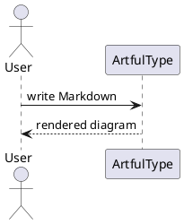

# Diagram Examples

ArtfulType Pro renders these fenced code blocks as diagrams in Writer mode.
Use the diagram button in the toolbar, or pick a "Diagram: …" language in a code block.

| Fence tag(s) | Engine | Needs |
| --- | --- | --- |
| `mermaid` | Mermaid | built-in |
| `plantuml`, `puml`, `uml` | PlantUML | local `plantuml` or `java` + `plantuml.jar` (`ARTFULTYPE_PLANTUML`) |
| `d2` | D2 | local `d2` binary (`ARTFULTYPE_D2`) |
| `markmap` | Markmap | built-in |
| `svgbob`, `bob`, `ascii`, `asciiart` | Svgbob (ASCII / Unicode) | built-in |

## PlantUML



## D2

```d2
direction: right
writer: Writer {shape: person}
app: ArtfulType Pro
file: Markdown file {shape: page}
writer -> app: types
app -> file: saves
```

## Markmap

```markmap
# ArtfulType Pro
## Writing
- Markdown
- Footnotes
## Diagrams
- Mermaid
- PlantUML
- D2
```

## ASCII / Unicode

```svgbob
┌──────────┐       +-----------+
│  Writer  │──────>|  Markdown |
└──────────┘       +-----+-----+
                         |
                         v
                   .-----------.
                  (   Diagram   )
                   '-----------'
```
