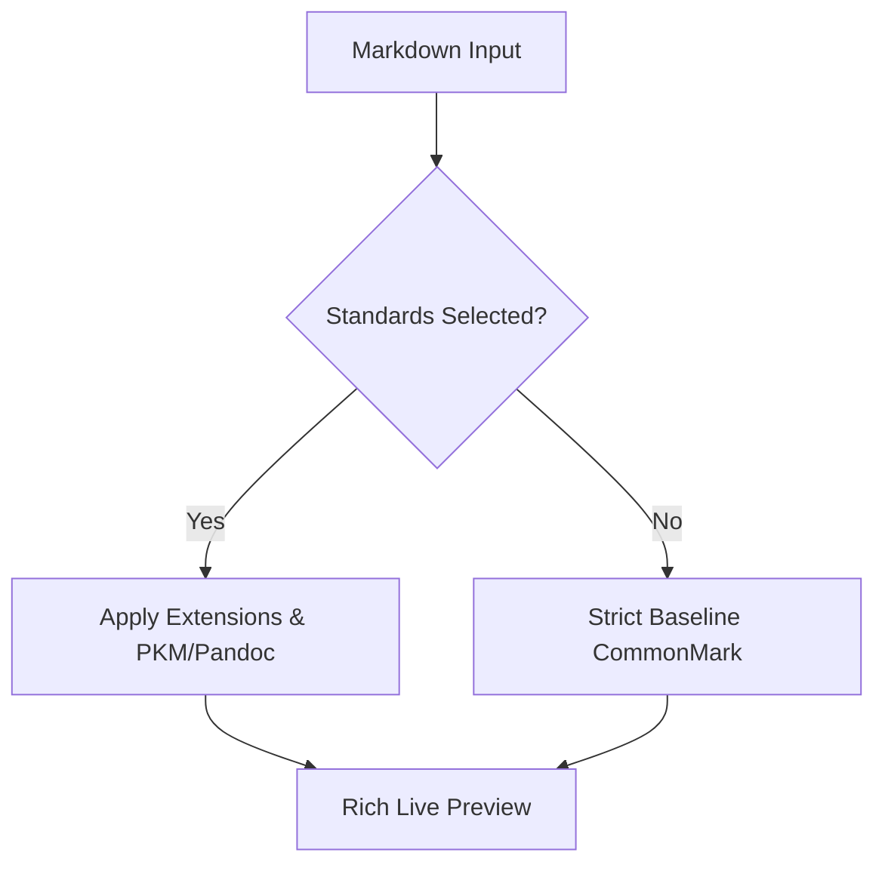

## Markdown Standards & Extensions Compatibility

ArtfulType Pro provides native, modular compatibility with modern note-taking, technical publishing, and document standards:

1. **CommonMark Specification** (Core Baseline)
2. **GitHub Flavored Markdown** (GFM)
3. **Modern Note-Taking & PKM Standards** (Obsidian, Roam, Logseq)
4. **Technical Documentation & Pandoc Extensions** (Fenced Divs, Bracketed Spans, Citations, Inline Footnotes)
5. **Native Diagram Code Blocks** (Mermaid, PlantUML, D2, Markmap, Svgbob, Vega/Vega-Lite)
6. **MDX & Component Support** (Embedded JSX/Components)
7. **Alternative Frontmatter Formats** (YAML `---`, TOML `+++`, JSON `;;;`, MultiMarkdown)
8. **Markdown Extra** (Definition Lists, Heading Attributes, Abbreviations, Footnotes)
9. **MultiMarkdown** (LaTeX Math, Sub/Superscript, CriticMarkup)
10. **Polyglot & R Markdown** (Executable Code Chunks)
11. **Smart Typography** (SmartyPants)
12. **HTML Embeds & Sanitization** (Safe Tags vs Raw Passthrough)

---

## 1. CommonMark Baseline Specification

CommonMark is the unambiguous baseline foundation of Markdown. If all extensions are disabled, ArtfulType Pro strictly renders CommonMark:

### Typography & Structure

Paragraphs render cleanly with *italic* (`*italic*` or `_italic_`), **bold** (`**bold**` or `__bold__`), and ***bold-italic***.

Hard line breaks are created by two trailing spaces or a backslash.

> Nested blockquotes work seamlessly:
>
> > Multi-level depth with clean visual hierarchy.

#### Lists

- Bullet list item 1
  - Nested unordered item A
  - Nested unordered item B
- Bullet list item 2

1. Ordered item 1
2. Ordered item 2
   1. Sub-item 2.1
   2. Sub-item 2.2

---

## 2. GitHub Flavored Markdown (GFM)

### Tables with Alignment

| Feature | Flavor | Status | Priority |
| :--- | :---: | :---: | ---: |
| CommonMark Compliance | Core | ✅ Enabled | Baseline |
| GFM Task Lists & Tables | GFM | ✅ Enabled | High |
| PKM Wikilinks & Embeds | PKM | ✅ Enabled | High |
| Pandoc Divs & Spans | Pandoc | ✅ Enabled | High |
| Vega / Vega-Lite | Diagram | ✅ Enabled | Medium |

### Task Lists

- [x] Integrate full pulldown-cmark specification flags
- [x] Support GFM callout blockquotes
- [x] Enable interactive checkboxes in Writer mode
- [x] Support modern PKM & Pandoc extensions

### Strikethrough & Autolinks

Strikethrough with `~~deprecated feature~~` renders as ~~deprecated feature~~.  
Autolinks: <https://github.com/darkcruix2/ArtfulType> and <user@example.com>.

### GFM Callouts / Alerts

> [!NOTE]
> Useful information that users should know, even when skimming.

> [!TIP]
> Helpful advice for doing things better or more easily.

> [!IMPORTANT]
> Key information users need to know to achieve their goal.

> [!WARNING]
> Urgent info that needs immediate user attention to avoid problems.

> [!CAUTION]
> Advises about risks or negative outcomes of certain actions.

---

## 3. Modern Note-Taking & PKM Standards (Obsidian, Roam, Logseq)

### Internal Wikilinks

Navigate effortlessly between notes in your vault:
- Standard Wikilink: [[Project Roadmap]]
- Aliased Wikilink: [[Project Roadmap|Q4 Delivery Plan]]
- Cross-note link: [[Meeting Notes 2026-10-16|Weekly Sync]]

Clicking any wikilink in the Writer view instantly switches to the target note tab or opens it from your directory.

### Media & Note Transclusions (Embeds)

Embed images or transclude entire notes using `![[...]]` syntax:

![[diagram.png|400]]

Transcluded note card:

![[Architecture Overview]]

### Text Highlighting

Highlight crucial passages across your notes using `==highlighted text==`:

==This critical finding is highlighted using modern PKM syntax.==

---

## 4. Technical Documentation & Pandoc Extensions

### Fenced Divs & Callouts

Pandoc-style container blocks provide structured styling:

::: warning
**Security Notice:** Always sanitize untrusted user inputs before passing to DOM sinks.
:::

::: {.callout-note title="Reproducibility Tip"}
Verify all dependencies are pinned in your lockfile before deploying.
:::

::: custom-sidebar
This container is styled using a custom class name via `::: custom-sidebar`.
:::

### Bracketed Spans

Inline styling with custom classes and IDs using Pandoc syntax `[text]{.class #id}`:

Status: [Production Ready]{.pandoc-span .badge-success #deploy-status} and [Deprecated API]{.pandoc-span .badge-danger}.

### Pandoc Citations

Reference bibliography keys using in-text `@author` and bracketed `[@key]` syntax:

As demonstrated by @knuth1984 in foundational work, reproducible computing relies on literate programming [@knuth1984; @lamport1994; @smith2024, p. 45].

### Inline Footnotes

Define footnotes directly inline using `^[...]` syntax without jumping to the bottom of the page:

Here is a statement with an inline footnote^[This footnote is written directly in the sentence flow using Pandoc inline syntax].

---

## 5. Native Diagram Code Blocks

### Vega & Vega-Lite Visualization

```vega
{
  "$schema": "https://vega.github.io/schema/vega-lite/v5.json",
  "description": "Markdown Standards Support in ArtfulType Pro",
  "data": {
    "values": [
      {"standard": "CommonMark", "count": 12},
      {"standard": "GFM", "count": 20},
      {"standard": "PKM", "count": 16},
      {"standard": "Pandoc", "count": 18},
      {"standard": "MMD", "count": 14}
    ]
  },
  "mark": "bar",
  "encoding": {
    "x": {"field": "standard", "type": "nominal", "axis": {"labelAngle": 0}},
    "y": {"field": "count", "type": "quantitative"}
  }
}
```

### Mermaid Diagram



### Svgbob Diagram (ASCII to SVG)

```svgbob
┌───────────────┐       +─────────────────────────+
│ Note / Docs   │──────>| ArtfulType Pro Engine   │
└───────────────┘       +------------+------------+
                                     |
                                     v
                        .-------------------------.
                       (  Pixel-Perfect Rendering  )
                        '-------------------------'
```

---

## 6. MDX & Embedded Component Support

For modern documentation frameworks (Docusaurus, VitePress, Astro, Next.js), embedded components render with visual inspector cards:

<Card title="Quick Setup" icon="rocket">
  Install ArtfulType Pro on Linux, macOS, or Windows to begin typing.
</Card>

<Badge variant="success">v0.30.11</Badge>

<Tabs default="npm">
  Tabbed documentation content can be organized cleanly.
</Tabs>

---

## 7. Alternative Frontmatter Formats

ArtfulType Pro natively supports:
- **YAML Frontmatter**: `---` ... `---`
- **TOML Frontmatter**: `+++` ... `+++`
- **JSON Frontmatter**: `;;;` ... `;;;` (common in Hugo and Zola)
- **MultiMarkdown Metadata**: Key-value pairs at file start

---

## 8. Markdown Extra

### Heading Attributes {#custom-anchor .special-header}

Headings support custom IDs and classes with `{#custom-anchor .special-header}` syntax.

### Definition Lists

ArtfulType Pro
:   A distraction-free Markdown & Code editor built with Rust and Tauri.
:   Available natively for Linux, macOS, Windows, and the terminal.

CommonMark
:   A strongly specified, highly compatible implementation of Markdown.

### Abbreviations

*[HTML]: Hyper Text Markup Language
*[CSS]: Cascading Style Sheets
*[API]: Application Programming Interface

Abbreviations such as HTML, CSS, and API are automatically detected and rendered with subtle dotted underlines and explanatory tooltips.

---

## 9. MultiMarkdown (MMD)

### LaTeX Mathematics

Inline mathematics: $E = mc^2$ and Euler's identity $e^{i\pi} + 1 = 0$.

Display equations rendered natively via bundled KaTeX:

$$
f(x) = \frac{1}{\sigma \sqrt{2\pi}} \exp\left( -\frac{1}{2}\left(\frac{x - \mu}{\sigma}\right)^{\!2}\,\right)
$$

### Subscript & Superscript

Chemical formulas like H~2~O and CO~2~ use subscript (`~2~`).  
Exponentials like x^2^ + y^2^ = z^2^ use superscript (`^2^`).

### CriticMarkup

CriticMarkup enables collaborative editing and tracked changes:

- Addition: {++this text was added++}
- Deletion: {--this text was removed--}
- Substitution: {~~old draft~>revised final draft~~}
- Comment: {>>Please verify this theorem with recent papers<<}
- Highlight: {==critical section that needs review==}

---

## 10. Polyglot & R Markdown

```{r data-summary, echo=TRUE, eval=FALSE, fig.width=8}
# Load datasets and compute summary statistics
data(cars)
summary(cars)
model <- lm(dist ~ speed, data = cars)
plot(cars, main = "Speed vs Stopping Distance")
abline(model, col = "#bd93f9", lwd = 2)
```

Inline code evaluation representation: R version `r getRversion()`.

---

## 11. Smart Typography (SmartyPants)

When Smart Typography is enabled:
- Straight double quotes "Hello World" automatically become curly quotes “Hello World”.
- Straight single quotes 'quotes' become curly quotes ‘quotes’.
- Double hyphens -- become en-dashes –.
- Triple hyphens --- become em-dashes —.
- Triple periods ... become typographic ellipses ….

---

## 12. HTML Embeds & Granular Sanitization

Granular control toggle allows selecting between raw HTML passthrough or strict sanitization:

Keyboard shortcut badges: Press <kbd>Ctrl</kbd> + <kbd>S</kbd> to save.

Collapsible details:
<details>
  <summary>Click to view system diagnostics</summary>
  <p>All 9 Markdown standards active and validated.</p>
</details>
